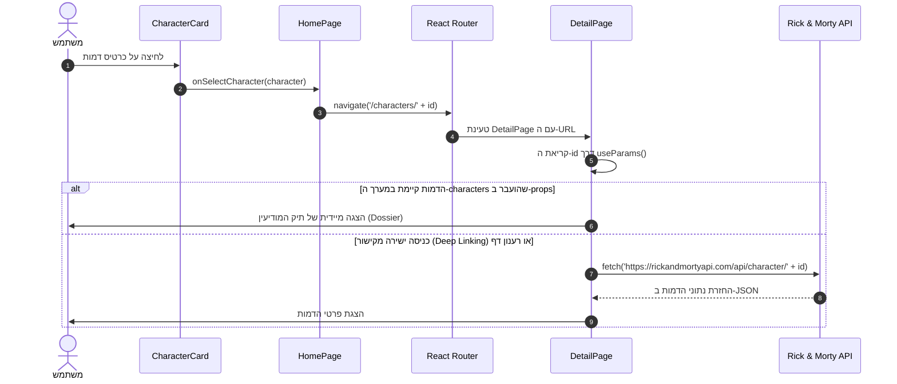

# ארכיטקטורת המערכת וזרימת הנתונים (System Architecture)

מסמך זה מתאר את מבנה הרכיבים, העמודים, ניהול ה-State וזרימת המידע (Props Flow) באפליקציית **Rick and Morty Explorer**.

---

## 🗺️ 1. מפת עמודים ונתיבים (Routes)

האפליקציה מנוהלת באמצעות **React Router 7** מתוך `main.tsx` (`BrowserRouter`) ו-`App.tsx` (`Routes`):

| כתובת (Route) | עמוד (Page Component) | תיאור התוכן |
|---|---|---|
| `/` או `/characters` | `HomePage.tsx` | סייר דמויות ראשי (Master View), תיבת חיפוש וסינון סטטוס בזמן אמת, טיפול בטעינה ושגיאה. |
| `/characters/:id` | `DetailPage.tsx` | עמוד פרטי דמות מורחב (Detail View / Dossier), קריאת ה-`id` עם `useParams`, שליפה ישירה מה-API במידת הצורך (Deep Linking). |
| `/items/:id` | `DetailPage.tsx` | תמיכה ישירה בנתיב המבוקש במחוון הקורס. |
| `/favorites` | `FavoritesPage.tsx` | כספת אישית של דמויות שסומנו בכוכב מועדף, שמירה ב-`localStorage`, חיפוש פנימי ואיפוס. |
| `/stats` | `StatsPage.tsx` | מדדים דמוגרפיים חיים: יחסי הישרדות (Alive / Dead / unknown), פילוח גזעים וכפתור טלפורטציה אקראי. |
| `*` | `NotFoundPage.tsx` | עמוד 404 מעוצב לנתיבים שלא קיימים עם כפתור חזרה לממד C-137. |

---

## 🧱 2. עץ הרכיבים (Component Hierarchy)

```
[main.tsx]
   └── <BrowserRouter>
         └── <App> (שליפת API ראשית, ניהול מועדפים ב-localStorage)
               ├── <Header> (סרגל ניווט עליון NavLink, באנר הירו, קפסולות ומידע)
               └── <main className="main-content">
                     └── <Routes>
                           ├── Route: "/" ──> <HomePage>
                           │                    ├── <FilterBar> (חיפוש טקסט, סינון סטטוס, טוגל מועדפים)
                           │                    ├── <LoadingState> (מצב טעינה עם ספינר)
                           │                    ├── <ErrorState> (מצב שגיאה עם כפתור Retry)
                           │                    ├── <EmptyState> (הודעה מעוצבת כשאין תוצאות + כפתור Reset)
                           │                    └── <CharacterList>
                           │                          └── <CharacterCard> (כרטיס דמות עם תג סטטוס וכוכב מועדף)
                           │
                           ├── Route: "/characters/:id" ──> <DetailPage>
                           │                                  ├── useParams() לשליפת ה-id
                           │                                  └── Dossier תצוגת מפרט מלאה (Origin, Location, Episodes)
                           │
                           ├── Route: "/favorites" ──> <FavoritesPage>
                           │                             └── <CharacterCard> (כרטיסי מועדפים מסונכרנים)
                           │
                           ├── Route: "/stats" ──> <StatsPage>
                           │                         ├── פסי התקדמות של אחוזי הישרדות
                           │                         ├── טבלת גזעים מובילים
                           │                         └── כפתור טלפורטציה המגריל דמות ומנווט לפרטיה
                           │
                           └── Route: "*" ──> <NotFoundPage> (עמוד 404 מעוצב)
```

---

## 🔄 3. ניהול State וזרימת נתונים (Props Flow)

### א. איפה נשמר ה-State המרכזי ולמה?
1. **רשימת הדמויות (`characters`):**
   - **מיקום:** נשמר ב-`App.tsx` (הרכיב העליון).
   - **הסיבה:** הדמויות משמשות גם את ה-`HomePage`, גם את עמוד ה-`FavoritesPage` (לצורך התאמת ה-IDs לפרטי הדמות) וגם את ה-`StatsPage` (לחישוב הסטטיסטיקות).
2. **מועדפים (`favorites`):**
   - **מיקום:** נשמר ב-`App.tsx` ומסונכרן מיידית ל-`localStorage` תחת המפתח `'rick_morty_favorites'`.
   - **הסיבה:** סימון כוכב ב-`CharacterCard` או ב-`DetailPage` חייב לעדכן מיידית את ספירת המועדפים בסרגל הניווט העליון (`Header`), בעמוד הבית, ובכספת המועדפים (`FavoritesPage`).
3. **מסננים וחיפוש (`searchTerm`, `statusFilter`, `showFavoritesOnly`):**
   - **מיקום:** נשמרים מקומית ב-`HomePage.tsx`.
   - **הסיבה:** מצב החיפוש שייך ישירות לתצוגת הסייר ואינו משפיע על דפים אחרים.

---

## ⚡ 4. מחזור חיים של לחיצה על דמות (Master to Detail Flow)



---

## 🧪 5. בדיקות יחידה ומודול הלוגיקה (Vitest)

הלוגיקה החישובית הופרדה לקובץ טהור (`src/utils/filterUtils.ts`):
- `filterCharacters(...)` — סינון לפי שם (ללא תלות באותיות קטנות/גדולות, עם `trim`), לפי סטטוס ולפי מועדפים.
- `toggleFavoriteId(...)` — הוספה והסרה של מזהה מרשימת המועדפים (אימיוטבילי).
- `calculateMultiverseStats(...)` — חישוב מדדי הישרדות (Alive, Dead, unknown) ופילוח גזעים.
- `formatEpisodeCount(...)` — עיצוב תקני ליחיד/רבים של פרקים.

על בסיס פונקציות אלו ורכיבי הממשק נכתבו **14 בדיקות יחידה** ב-Vitest (`npm test`), וכולן עוברות ב-100% הצלחה.
